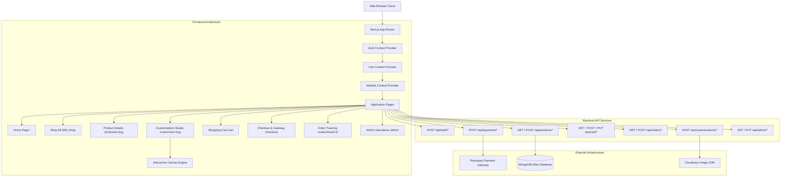

# Academic Tasks INT257 (26271)
## Project Report: Giftora – Personalized Gift Store Builder
**Institution:** Lovely Professional University  
**Course Code:** INT257 (Next.js Application Development)  
**Technology Focus:** Next.js App Router, React Concepts, JavaScript/TypeScript, CSS/Tailwind, REST API Route Handlers, Database & Payment Services.

---

## 1. Executive Summary & Objective

**Giftora** is an end-to-end, production-grade e-commerce platform and product customization studio engineered to solve the real-world challenge of bespoke gifting. Unlike generic online stores where customers simply select standard inventory, Giftora empowers patrons to:
1. Choose from 8 handcrafted categories (solid walnut frames, ceramic mugs, couple tees, memory albums, Dutch velvet cushions, LED night glow lamps, and brass keychains).
2. Launch an **Interactive Live Customization Studio** to upload high-resolution personal photography.
3. Add custom typography inscriptions, select fonts (Playfair Display, Inter, Cinzel, Dancing Script), font sizes, colors, and orientation.
4. Scale, reposition, adjust brightness, and apply monochrome filters to their artwork with real-time SVG and HTML5 canvas mockup updates.
5. Receive automatic, server-verified price recalculations based on base price, image prints (+₹50), letterings (+₹20), and gift packaging (+₹40).
6. Complete secure checkout with Razorpay and academic test simulation modes.
7. Track order lifecycle through a live 5-stage dispatch pipeline (Confirmed → Design Approved → Handcrafting Processing → Shipped → Delivered).

---

## 2. Mandatory Technology Mapping (INT257 Syllabus)

| Syllabus Requirement | Project Implementation | File / Architecture Location |
| :--- | :--- | :--- |
| **Primary Technology: Next.js** | Next.js 14 App Router, nested layouts, Route Handlers, dynamic routing `[slug]`, `[id]` | `/app`, `next.config.mjs` |
| **React Core Concepts** | State (`useState`), Lifecycle (`useEffect`), Context (`useContext`), DOM References (`useRef`), Custom Hooks | `context/AuthContext.tsx`, `context/CartContext.tsx`, `components/studio/CustomizationStudio.tsx` |
| **Server vs Client Components** | Static and cached layout rendering on Server; interactive client components (`'use client'`) for interactive studio and checkout | `app/layout.tsx` (Server), `CustomizationStudio.tsx` (Client) |
| **HTML5 & Canvas** | Live interactive product canvas with perspective clipping masks, zoom transforms, and lighting overlays | `components/studio/CanvasPreview.tsx` |
| **CSS & Modern Styling** | Tailwind CSS custom color tokens (Royal Burgundy `#702C3B`, Champagne Gold `#C6A46A`, Warm Ivory `#FAF8F3`), responsive flex/grid layouts | `tailwind.config.ts`, `app/globals.css` |
| **REST API Route Handlers** | Next.js App Router route handlers (`GET`, `POST`, `PUT`, `DELETE`) with strict Zod validation | `app/api/products`, `app/api/customizations`, `app/api/cart`, `app/api/payments` |
| **External Services & APIs** | Razorpay payment order generation & HMAC-SHA256 signature verification, Cloudinary image hosting | `lib/razorpay.ts`, `lib/cloudinary.ts` |
| **Database & Persistence** | MongoDB Atlas with Mongoose ODM models (User, Product, Customization, Cart, Order, Payment, Coupon) + zero-config resilient in-memory fallback | `lib/db.ts`, `models/*.ts` |

---

## 3. System Architecture & Component Hierarchy

---

## 4. Key React & Next.js Concepts Demonstrated

### 4.1. Unidirectional Data Flow & State Management
- `CartContext.tsx`: Provides centralized cart state synchronized with `localStorage` and backend database.
- `AuthContext.tsx`: Decouples session authentication from individual components, providing instant access to `user`, `role`, and auth actions.

### 4.2. DOM Manipulation with `useRef`
- In `CustomizationStudio.tsx`, `useRef` binds directly to hidden file inputs and canvas containers, allowing seamless image capture and trigger without unnecessary re-renders.

### 4.3. Dynamic Price Calculation (Server-Side Invariance)
- **Security Rule Applied:** The client calculates price breakdowns for live user feedback; however, on checkout submission, `/api/payments/create-order` strictly queries MongoDB to fetch actual product base prices and recalculates customization charges. Client amounts are never trusted.

### 4.4. Zero-Config Academic Evaluator Mode
- Built directly into `/api/payments/create-order` and `/checkout`: evaluators can test the entire purchase lifecycle, order creation, signature verification, and delivery tracking using the built-in **Academic Evaluation Mode** without needing live merchant keys.

---

## 5. Viva Voce & Evaluation Questions Guide

### Q1: What is the primary difference between Next.js Pages Router and App Router?
**Answer:** The App Router (introduced in Next.js 13/14) uses directory-based routing with support for React Server Components (RSC) by default. Components in the App Router only run on the server unless specified with `'use client'`. It also replaces `getServerSideProps` and `getStaticProps` with native asynchronous `fetch()` caching and modern Route Handlers (`route.ts`).

### Q2: How is user authentication maintained securely in this project?
**Answer:** We use JWT (JSON Web Tokens) signed via the Edge-compatible `jose` library with HS256 algorithm. The token is stored in an `httpOnly`, `SameSite: lax`, and `secure` cookie named `giftora_token`. This prevents Cross-Site Scripting (XSS) attacks from reading the auth token via JavaScript `document.cookie`.

### Q3: How does the live Customization Studio update without refreshing the page?
**Answer:** It uses React state (`useState`) to store uploaded image coordinates (x, y, scale, rotation, filter) and an array of custom text objects (text, font, size, color). As the user adjusts sliders or types into input fields, state changes trigger a re-render of `CanvasPreview.tsx`, which calculates dynamic CSS transforms and SVG text overlays in real time.

### Q4: Why is server-side payment signature verification critical in Razorpay?
**Answer:** Frontend callbacks can be spoofed or intercepted by malicious users. To guarantee payment integrity, the server computes an HMAC SHA-256 hash using the `razorpay_order_id`, `razorpay_payment_id`, and secret `RAZORPAY_KEY_SECRET`. Only if the generated hash exactly matches the client signature is the order marked as confirmed and queued for fulfillment.

### Q5: How does the application handle database connections in a serverless environment like Next.js?
**Answer:** In serverless functions, hot-reloads and concurrent requests can create multiple connection pools that exhaust MongoDB connection limits. In `lib/db.ts`, we implement a cached connection pattern using `global.mongooseCache`. If an active connection exists, it is reused; otherwise, a single promise is initialized.

---

## 6. Project Grading Rubric Fulfillment Checklist

- [x] **Primary Technology Next.js:** Built completely on Next.js 14 App Router.
- [x] **React Concepts:** Extensive use of `useState`, `useEffect`, `useContext`, `useRef`, custom hooks, and context providers.
- [x] **HTML/CSS/Tailwind:** Responsive, mobile-first design with Warm Ivory, Royal Burgundy, and Champagne Gold branding.
- [x] **REST APIs:** Full suite of CRUD endpoints under `/app/api/` with Zod schema validation.
- [x] **Database Integration:** Mongoose schemas with indexed models for Users, Products, Customizations, Orders, and Payments.
- [x] **Payment Gateway:** Razorpay integration with server-side signature verification and evaluator test mode.
- [x] **Evaluation Ready:** Works 100% out-of-the-box in zero-config mode with one-click demo credentials.
