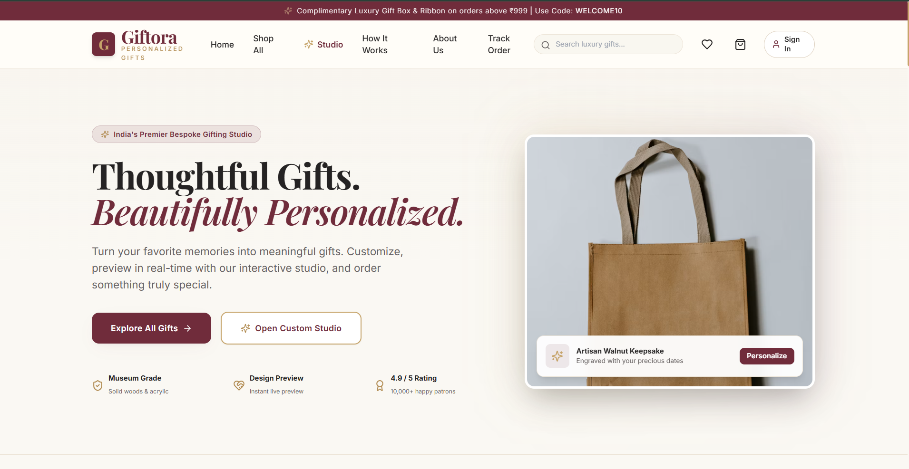
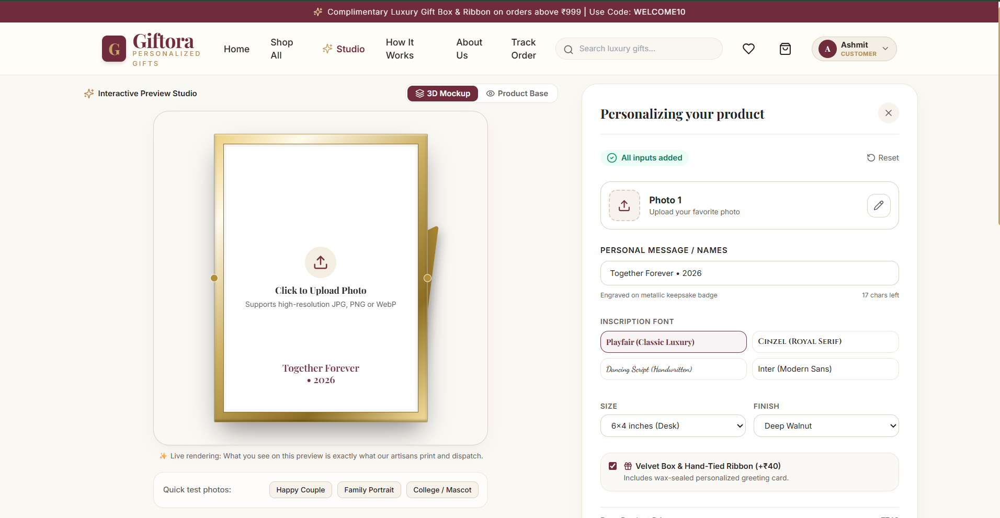
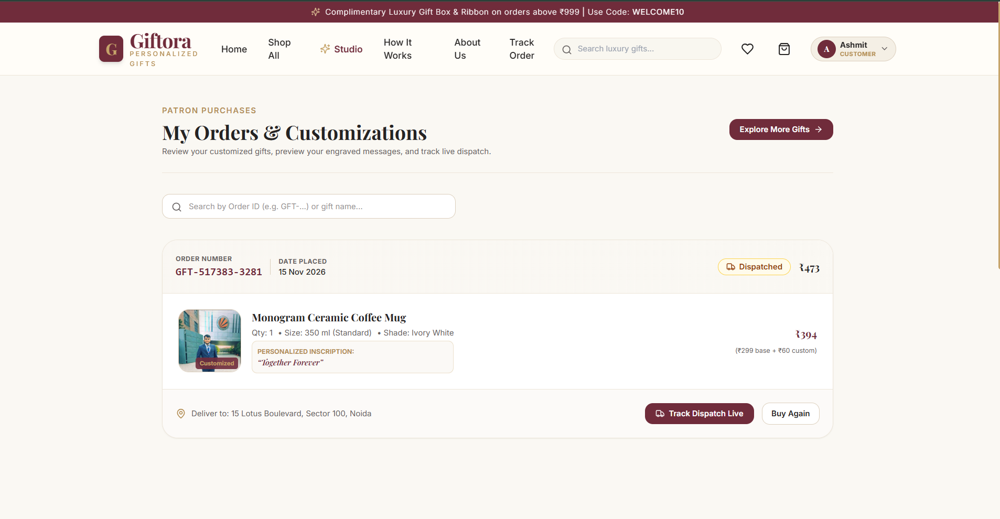
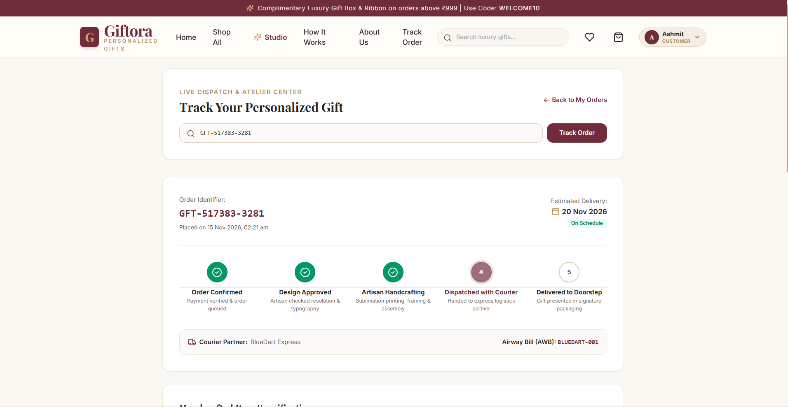

<!-- # Giftora – Personalized Gift Store Builder

> **"Make Every Gift Unforgettable."**  
> Built as an Academic Task for **INT257 (26271)** at **Lovely Professional University**.

Giftora is a full-stack, production-grade personalized gift e-commerce web application engineered with **Next.js 14 (App Router)**, **TypeScript**, **Tailwind CSS**, **MongoDB Atlas (Mongoose ODM)**, **Auth Sessions**, **Cloudinary**, and **Razorpay Payment Gateway**.

---

## 🌟 Key Features

### 1. Interactive Product Customization Studio
- **Real-Time Live Canvas Preview:** Instant visual feedback without page reload using dynamic SVG and CSS matrix transformations.
- **Photo Upload & Manipulation:** Supports JPG, PNG, and WebP with scaling (0.5x to 2.5x), X/Y positioning, rotation, brightness adjustments, and vintage Black & White grayscale toggles.
- **Custom Typography Inscriptions:** Add multiple text lines, choose from luxury serif and cursive fonts (*Playfair Display, Inter, Cinzel, Dancing Script, Montserrat*), customize font sizes, and select from royal palette swatches.
- **Persistent Design Configurations:** Customization parameters and previews are stored in the database and linked with orders.

### 2. Comprehensive E-Commerce Pipeline
- **Artisanal Product Catalog:** 8 categories including Photo Frames, Customized Mugs, Organic Cotton T-Shirts, Bonded Leather Photo Albums, Velvet Cushions, LED Photo Lamps, and Brass Keychains.
- **Server-Side Price Recalculation:** Base price + photo print charges (+₹50) + text inscriptions (+₹20) + luxury velvet packaging (+₹40) strictly re-calculated on the backend (Never trusting client-supplied amounts).
- **Shopping Cart with Free Shipping Progress:** Dynamic calculations, coupon code validation (*WELCOME10, GIFTORA100, FESTIVE20*), and session persistence.
- **Checkout & Razorpay Payment Gateway:**
  - Real Razorpay Checkout modal with server-side HMAC-SHA256 signature verification.
  - **Academic Evaluator Test Mode:** One-click instant verification simulation for evaluators testing without merchant keys!
- **Live 5-Stage Order Dispatch Tracking:** Real-time visual timeline (*Confirmed → Design Approved → Processing → Shipped → Delivered*) with carrier airway bill numbers and customer customization inspection.

### 3. Role-Based Administration Dashboard
- Real-time KPI metrics: Gross Revenue, Total Orders, Active Customers, Products, Pending Pipeline, and Low-stock inventory alerts.
- Order Management with production stage updates, courier tracking assignment, and customization reviews.
- Product catalog and customer directory management.
- One-click **Database Seed** button to populate sample products, coupons, and orders instantly.

---

## 🛠️ Technology Stack (INT257 Syllabus Alignment)

- **Framework:** Next.js 14 (App Router, Server & Client Components, Route Handlers)
- **Frontend Concepts:** React 18 (`useState`, `useEffect`, `useContext`, `useRef`), Framer Motion, Lucide React Icons
- **Styling:** Tailwind CSS (Royal Burgundy `#702C3B`, Champagne Gold `#C6A46A`, Warm Ivory `#FAF8F3`, Soft Beige `#EDE5D8`)
- **Backend:** Next.js Route Handlers (RESTful architecture, Zod schema validation)
- **Database:** MongoDB Atlas via Mongoose ODM (with zero-config in-memory fallback for immediate evaluation)
- **Authentication:** JWT Sessions signed via `jose`, bcrypt password hashing, `httpOnly` secure cookies
- **Payments:** Razorpay Node.js SDK + client checkout script + HMAC signature verification
- **Media Storage:** Cloudinary CDN integration with automatic data-URL fallback

---

## 🚀 Quick Start Guide

### 1. Installation
Clone the repository and install dependencies:
```bash
npm install
```

### 2. Environment Configuration
Create a `.env.local` file in the root directory (a pre-configured `.env.example` is provided):
```env
# Database
MONGODB_URI=mongodb+srv://<username>:<password>@cluster0.mongodb.net/giftora?retryWrites=true&w=majority

# Authentication
AUTH_SECRET=giftora_super_secret_jwt_key_2026_production_grade_change_in_prod
NEXT_PUBLIC_APP_URL=http://localhost:3000

# Cloudinary (Optional - has local base64 fallback)
CLOUDINARY_CLOUD_NAME=
CLOUDINARY_API_KEY=
CLOUDINARY_API_SECRET=

# Razorpay (Optional - has Academic Test Mode)
RAZORPAY_KEY_ID=rzp_test_giftora_demo_key
RAZORPAY_KEY_SECRET=giftora_demo_secret_2026
NEXT_PUBLIC_RAZORPAY_KEY_ID=rzp_test_giftora_demo_key
```

### 3. Run Development Server
```bash
npm run dev
```
Open [http://localhost:3000](http://localhost:3000) in your browser.

---

## 🔑 Demo Credentials for Evaluators

| Role | Email | Password | Access Rights |
| :--- | :--- | :--- | :--- |
| **Admin** | `admin@giftora.com` | `AdminPassword123!` | Full Admin Dashboard, Order & Product Management |
| **Customer** | `customer@giftora.com` | `Customer123!` | Shopping, Custom Studio, Order Tracking, Profile |

> **Pro-Tip:** On the `/login` page, click the **"Admin Demo"** or **"Customer Demo"** buttons for 1-click automatic authentication!

---

## 🧪 Testing Scenarios (Grading Checklist)

1. **Browsing:** Visit `/shop` and filter by category (*e.g. Photo Frames*), search by keyword, and sort by price.
2. **Custom Studio:** Click **"Personalize"** on any product or visit `/customize/artisan-walnut-wood-photo-frame`. Upload a photo or select a sample memory, adjust scale and position, type custom messages, choose fonts, and toggle gift packaging.
3. **Cart & Coupons:** Add customized item to cart (`/cart`). Apply promo code `WELCOME10` to get 10% off. Notice the free shipping threshold meter.
4. **Checkout:** Proceed to `/checkout`. Select **"Instant Verified Payment (Academic Evaluation Mode)"** or enter test card details for Razorpay.
5. **Success & Tracking:** View confirmation screen with confetti at `/payment/success`. Click **"Track Order Status"** to view live 5-step dispatch progress and customization inspection.
6. **Admin Dashboard:** Log in as admin and visit `/admin`. Inspect live revenue metrics, update order production stages at `/admin/orders`, and view customers at `/admin/customers`.

---

## 📄 Academic Project Report

For full architectural diagrams, component trees, and Viva Voce questions & answers, refer to [ACADEMIC_REPORT_INT257.md](file:///c:/Users/ASUS/Desktop/Project%205/ACADEMIC_REPORT_INT257.md).

---

## 📜 License
Developed for academic assessment at Lovely Professional University. All rights reserved. -->
# 🎁 Giftora – Personalized Gift Store Builder

> **“Make Every Gift Unforgettable.”**

Giftora is a personalized gift shopping platform where customers can turn their favourite memories into meaningful gifts. Customers can explore products, upload photos, add personal messages, choose fonts and finishes, and preview their designs before placing an order.

The project brings product customization, online shopping, customer accounts, order management, and delivery tracking together in one application.

---

## 🚀 Live Demo

**Try Giftora here:**

🔗 [Giftora – Personalized Gift Store](https://giftora-phi.vercel.app/)

---

## 📸 Screenshots

These screenshots show the actual Giftora application.

### 🏠 Homepage

The homepage introduces Giftora and gives customers quick access to the gift collection and customization studio.



### 🎨 Interactive Customization Studio

Customers can upload a photo, add a personal message, choose an inscription font, select product size and finish, and preview the personalized product.



### 📦 My Orders & Customizations

Customers can review their purchases, order details, personalized inscriptions, prices, and dispatch status.



### 🚚 Order Tracking

The tracking page shows the order journey, estimated delivery date, courier partner, and airway bill information.



---

## ✨ Features

### 1. Interactive Product Customization Studio

- **Live Product Preview:** See the design update while customizing a product.
- **Photo Upload:** Upload personal photos in JPG, PNG, and WebP formats.
- **Image Editing:** Adjust image scale, position, rotation, brightness, and grayscale effects.
- **Personal Messages:** Add names, dates, and custom inscriptions to gifts.
- **Font Selection:** Choose from styles such as Playfair Display, Cinzel, Dancing Script, Inter, and Montserrat.
- **Product Options:** Select available sizes and finishes.
- **Gift Packaging:** Add a velvet box and hand-tied ribbon where available.
- **Saved Customization:** Keep design details connected with the relevant order.

### 2. E-Commerce Experience

- **Product Catalogue:** Browse personalized gifts across categories such as photo frames, ceramic mugs, T-shirts, photo albums, cushions, LED photo lamps, and brass keychains.
- **Shopping Cart:** Add products and review items before checkout.
- **Coupon Codes:** Apply supported promotional codes such as `WELCOME10`, `GIFTORA100`, and `FESTIVE20`.
- **Dynamic Pricing:** The server recalculates the product total using the selected customization options.
- **Checkout:** Place an order through the available checkout and payment flow.
- **Order Confirmation:** View the order confirmation after checkout.

### 3. Order Management & Tracking

- **My Orders:** View previous purchases and their customization details.
- **Five-Stage Tracking:** Follow an order through:
  1. Order Confirmed
  2. Design Approved
  3. Artisan Handcrafting
  4. Dispatched with Courier
  5. Delivered to Doorstep
- **Courier Details:** View courier partner and airway bill information when available.
- **Estimated Delivery:** Check the expected delivery date.
- **Buy Again:** Start another purchase from a previous order.

### 4. Admin Dashboard

- **Dashboard Metrics:** View key information such as revenue, orders, customers, products, pending orders, and low-stock alerts.
- **Order Management:** Review orders and update their production or dispatch stages.
- **Customization Review:** Check the customer's submitted design details.
- **Product Management:** Add, edit, and manage products.
- **Customer Directory:** View customer records.
- **Seed Data:** Populate sample products, coupons, and orders for demonstration.

### 5. Authentication & User Experience

- Customer and administrator access.
- Password hashing and JWT-based authentication sessions.
- Responsive layouts for different screen sizes.
- A warm visual theme using burgundy, champagne gold, and ivory.
- Interactive controls, icons, and animations.

---

## 🛠️ Technology Stack

| Area | Technologies |
|---|---|
| Framework | Next.js 14 (App Router) |
| Frontend | React 18, TypeScript |
| Styling | Tailwind CSS |
| Animations | Framer Motion |
| Icons | Lucide React |
| Backend | Next.js Route Handlers |
| Database | MongoDB Atlas |
| ODM | Mongoose |
| Authentication | JWT, `jose`, bcrypt |
| Validation | Zod |
| Image Storage | Cloudinary |
| Deployment | Vercel |

---

## ⚙️ Run the Project Locally

### 1. Clone the repository

```bash
git clone YOUR_GITHUB_REPOSITORY_URL
cd giftora
```

Replace `YOUR_GITHUB_REPOSITORY_URL` with the actual GitHub repository URL.

### 2. Install dependencies

```bash
npm install
```

### 3. Configure environment variables

Create a `.env.local` file in the project root. Add the variables required by your local setup:

```env
# Database
MONGODB_URI=your_mongodb_connection_string

# Authentication
AUTH_SECRET=your_secure_auth_secret
NEXT_PUBLIC_APP_URL=http://localhost:3000

# Cloudinary (if configured)
CLOUDINARY_CLOUD_NAME=
CLOUDINARY_API_KEY=
CLOUDINARY_API_SECRET=

# Payment provider
# Add the actual environment variable names required by your integration.
```

Keep real credentials private. Do not commit `.env.local` or secret keys to GitHub. Check `.env.example` in the repository for the exact variable names used by your current code.

### 4. Start the development server

```bash
npm run dev
```

### 5. Open the application

Visit:

```text
http://localhost:3000
```

---

## 🧪 Suggested Testing Flow

1. Open the shop and browse the available gift categories.
2. Open a product in the customization studio.
3. Upload a photo or choose an available sample image.
4. Add a message and try different fonts and product options.
5. Check the live preview and add the customized product to the cart.
6. Apply a supported coupon code and review the cart total.
7. Continue through checkout using the payment option configured in the application.
8. Open **My Orders** and inspect the order details.
9. Open the tracking page and review the delivery stages.
10. If admin demo access is configured, explore the dashboard and order-management features.

---

## 🔒 Privacy & Security

Giftora includes several measures to protect application data:

- Passwords are hashed using bcrypt.
- Authentication uses JWT-based sessions.
- Server-side validation is used for incoming data.
- Product totals are recalculated on the server rather than relying only on client-submitted prices.
- Database and service credentials are stored in environment variables.
- Customer, product, and order information is managed through MongoDB.

---

## 📜 License

All rights reserved.

---

**Built with creativity and a love for meaningful gifts. ❤️**

*Giftora – Because the best gifts are personal.*
